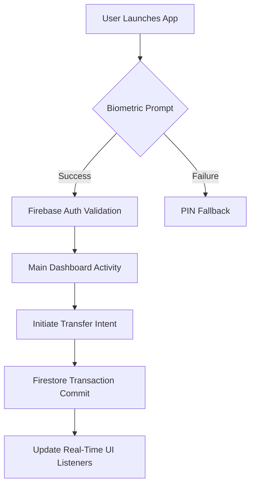

<div align="center">

# Intent Pay

**A secure, biometric-authenticated financial Android application demonstrating cutting-edge mobile payment architecture using Java and Firebase.**

[](LICENSE)
[](https://developer.android.com/)
[](https://java.com/)
[](https://firebase.google.com/)

[Report Bug](https://github.com/Justinvcj/Intent_Pay/issues) * [Request Feature](https://github.com/Justinvcj/Intent_Pay/issues)

</div>

---

```
+-----------------------------------------------------------------------------+
|                      Intent Pay Application Architecture                    |
|                                                                             |
|  +-----------------------+  +-----------------------+  +-----------------+  |
|  | Biometric Auth        |  | Firestore Realtime    |  | Firebase Auth   |  |
|  | (Fingerprint/Face)    |  | Transaction Sync      |  | JWT Validation  |  |
|  +----------+------------+  +----------+------------+  +--------+--------+  |
|             |                          |                        |           |
|             +--------------------------+------------------------+           |
|                                        v                                    |
|  +-----------------------------------------------------------------------+  |
|  |    Android App UI (Java/XML) * Encrypted SharedPreferences * Intents  |  |
|  +-----------------------------------------------------------------------+  |
+-----------------------------------------------------------------------------+
```

> Modern mobile payment apps require uncompromising security paired with frictionless UX.
> Intent Pay demonstrates how to build a robust financial Android application using biometric prompt APIs, secure credential storage, and Firebase's real-time infrastructure to sync transaction histories instantly across devices.

---

## Features

- **Biometric Authentication** -- Integrates `androidx.biometric` for secure, hardware-backed fingerprint and facial recognition login.
- **Real-Time Transaction Sync** -- Leverages Cloud Firestore to immediately synchronize balances and transfer histories across user devices.
- **Secure Authentication Flow** -- Utilizes Firebase Authentication for robust user identity management and session handling.
- **Encrypted Local Storage** -- Secures sensitive user preferences and session tokens using Android's EncryptedSharedPreferences.
- **Material Design UI** -- Implements modern Android XML layouts, custom vector drawables, and fluid Activity transitions via Explicit Intents.

---

## How It Works



---

## Quick Start

### Prerequisites

| Requirement | Version | Notes |
|---|---|---|
| [Android Studio](https://developer.android.com/studio) | Hedgehog+ | Official IDE |
| [Java JDK](https://adoptium.net/) | 11 or 17 | Required by Gradle |
| Android SDK | API 24+ | Min SDK required |

### Installation

1. Clone the repository:
   ```bash
   git clone https://github.com/Justinvcj/Intent_Pay.git
   cd Intent_Pay
   ```

2. Open the project in **Android Studio**.

3. Sync Gradle files to download dependencies.

### Configuration

This app requires a valid `google-services.json` file to connect to Firebase.
1. Create a project in the [Firebase Console](https://console.firebase.google.com/).
2. Register an Android app with the package name `com.example.intentpay` (or your updated package name).
3. Enable **Authentication** (Email/Password) and **Firestore Database**.
4. Download the `google-services.json` file and place it in the `app/` directory.

### Running

Select an emulator or physical device in Android Studio and click **Run** (Shift + F10).

---

## Contributing

Contributions are welcome. Please open an issue first to discuss what you would like to change.

1. Fork the Project
2. Create your Feature Branch (`git checkout -b feat/AddQRScan`)
3. Commit your Changes (`git commit -m 'feat: add QR code scanning for payments'`)
4. Push to the Branch (`git push origin feat/AddQRScan`)
5. Open a Pull Request

---

## License

Distributed under the MIT License. See [LICENSE](LICENSE) for details.