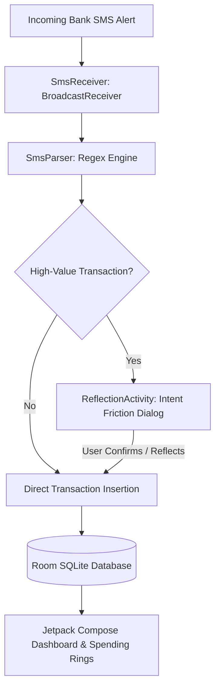

<div align="center">

# Intent Pay

**Native privacy-first Android expense tracker that intercepts bank SMS alerts offline to classify transactions and curb impulse spending.**

[](LICENSE)
[](https://kotlinlang.org)
[](https://developer.android.com/jetpack/compose)
[](https://developer.android.com/training/data-storage/room)
[](https://developer.android.com)

[Report Bug](https://github.com/Justinvcj/Intent_Pay/issues) · [Request Feature](https://github.com/Justinvcj/Intent_Pay/issues)

</div>

---

```
┌──────────────────┐      ┌────────────────────────┐      ┌───────────────────────┐
│ Incoming Bank    │ ───► │ Android Broadcast      │ ───► │ Local Deterministic   │
│ SMS Notification │      │ Receiver (Zero Cloud)  │      │ Regex Parsing Engine  │
└──────────────────┘      └────────────────────────┘      └───────────┬───────────┘
                                                                      │
┌──────────────────┐      ┌────────────────────────┐                  ▼
│ Jetpack Compose  │ ◄─── │ Room SQLite Database   │ ◄─── ┌───────────────────────┐
│ Glassmorphic UI  │      │ & Budget Table Entity  │      │ High-Value Reflection │
└──────────────────┘      └────────────────────────┘      │ Behavioral Friction UI│
                                                          └───────────────────────┘
```

> Existing personal budget apps rely on delayed cloud bank syncing and passive tracking, failing to intervene at the critical moment of purchase.
> Intent Pay operates 100% offline, intercepting bank SMS transaction alerts in real time through native Android broadcast receivers and introducing deliberate reflection friction overlays on high-value purchases.

---

## Features

- **100% Offline Privacy** — Stores and processes all financial transaction data on device without cloud telemetry or external network calls.
- **Zero-Latency SMS Interception** — Listens for incoming banking SMS notifications instantly using native Android `BroadcastReceivers` (`SmsReceiver.kt`).
- **Deterministic Expense Classifier** — Extracts transaction amounts, merchant names, and categories with local regex rules (`KeywordRuleMatcher.kt`).
- **Behavioral Reflection Overlay** — Displays an immediate friction modal (`ReflectionActivity.kt`) on high-value purchases to prevent impulse spending.
- **Glassmorphic Compose UI** — Features custom glass cards (`GlassCard.kt`), mesh backgrounds (`MeshBackground.kt`), and dynamic spending rings.
- **Google Sheets & CSV Export** — Supports periodic background synchronization and manual spreadsheet export via Android WorkManager.

---

## How It Works



---

## Android Permissions

Intent Pay requires the following explicit permissions for offline transaction detection:

| Permission | Purpose |
|---|---|
| `android.permission.RECEIVE_SMS` | Intercept incoming bank transaction SMS messages in real time |
| `android.permission.READ_SMS` | Historical transaction import during initial onboarding |
| `android.permission.POST_NOTIFICATIONS` | Send budget alerts and high-value reflection prompts |
| `android.permission.BIND_ACCESSIBILITY_SERVICE` | Optional UPI payment screen detection |

---

## Quick Start

### Prerequisites

| Requirement | Version | Notes |
|---|---|---|
| [Android Studio](https://developer.android.com/studio) | Flamingo (2022.2.1)+ | Official Android IDE |
| [JDK](https://adoptium.net/) | 17+ | Java Development Kit |
| [Android SDK](https://developer.android.com/about/versions) | API 24+ (Android 7.0+) | Minimum SDK target |

### Installation & Build

1. Clone the repository:
   ```bash
   git clone https://github.com/Justinvcj/Intent_Pay.git
   cd Intent_Pay
   ```

2. Open the project in **Android Studio**.

3. Build debug APK using Gradle:
   ```bash
   ./gradlew assembleDebug
   ```

4. Install on a connected physical Android device or emulator with SMS capabilities.

### Release signing

Release builds read signing credentials from environment variables (nothing is stored in the repo):

- `KEYSTORE_PATH`: path to the release keystore file
- `KEYSTORE_PWD`: keystore password
- `KEY_ALIAS`: key alias inside the keystore
- `KEY_PWD`: key password

If `KEYSTORE_PATH` is unset or the file does not exist, `assembleRelease` falls back to debug signing.

---

## Tech Stack

| Layer | Technology |
|---|---|
| Language | Kotlin |
| UI Framework | Jetpack Compose, Material Design 3, Glassmorphic Design System |
| Local Storage | Android Room Database, SQLite, Android DataStore |
| Background Processing | Android WorkManager, Kotlin Coroutines, StateFlow |
| Build System | Gradle Kotlin DSL (`build.gradle.kts`) |

---

## Contributing

Contributions are welcome. Please open an issue first to discuss what you would like to change.

1. Fork the Project
2. Create your Feature Branch (`git checkout -b feat/IntentFeature`)
3. Commit your Changes (`git commit -m 'feat: add intent feature'`)
4. Push to the Branch (`git push origin feat/IntentFeature`)
5. Open a Pull Request

---

## License

Distributed under the MIT License. See [LICENSE](LICENSE) for details.
